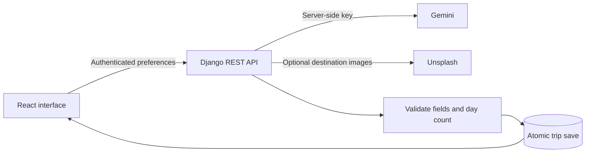

# Tourvisto

A React and Django travel-planning prototype: create an account, request a generated itinerary and browse saved trips. The application combines a travel dashboard, nested trip/day/activity records, JWT authentication and a Gemini-backed generation endpoint.

## Request flow



Provider credentials are read only by the backend. The browser sends preferences to `POST /trips/generate/`; it does not receive the keys. Generation validates the input, bounds duration to 1–21 days, validates model output, and saves the trip under the authenticated user. Image lookup failure does not prevent saving a valid itinerary.

## Run locally

Backend (Python 3.11+):

```sh
cd back/tourvisto
python -m venv .venv
# Activate .venv using your shell.
python -m pip install -r requirements.txt
# Copy .env.example to .env and fill values locally.
python manage.py migrate
python manage.py runserver
```

Set a fresh `DJANGO_SECRET_KEY`. `GEMINI_API_KEY` enables generation and `UNSPLASH_ACCESS_KEY` is optional. Keep `.env` out of Git. Configure `GEMINI_MODEL` for a model available to your provider account. `DEBUG` defaults to false; allowed hosts and CORS origins have local defaults.

Frontend (Node.js 22+):

```sh
cd front
npm ci
# Optional: copy .env.example to .env.local and set VITE_API_BASE_URL.
npm run dev
```

Only the public API base URL belongs in a `VITE_` variable. These variables are embedded in the browser bundle. Syncfusion components may require a license for your intended use; check its terms before deployment.

## Verify

```sh
cd back/tourvisto
python manage.py test
```

The tests exercise user/trip persistence and the actual generation endpoint: authentication, input bounds, ownership assignment, provider validation, timeout handling, throttling and nested-save rollback. Provider calls are mocked; passing tests do not imply that a key works or that a generated travel recommendation is accurate.

```sh
cd front
npm run build
```

## Scope and remaining work

This is a portfolio prototype. The dashboard currently exposes the shared trip catalogue and user listing to authenticated users; it is not a tenant-isolated service. Do not load real customer data. The six-generation-per-hour application throttle uses Django's configured cache; production would need a shared cache, account-level cost controls and an upstream request limit. Model suggestions require human checking. The frontend bundle is large and needs performance work before a production launch.

Earlier commits contained provider credentials. Moving keys to server configuration prevents further browser exposure but does not revoke copies already disclosed. Account owners must rotate previously exposed keys before treating them as confidential. Do not add replacements to source or issue reports.

## Main files

- `back/tourvisto/trips/generation.py`: provider requests and schema validation.
- `back/tourvisto/trips/views.py`: authenticated generation and trip endpoints.
- `back/tourvisto/trips/serializers.py`: atomic nested persistence.
- `back/tourvisto/trips/test_generation.py`: generation and failure-path tests.
- `front/src/Pages/newTrip/`: planner interface and backend action.

No production security certification or regulatory compliance is claimed.
