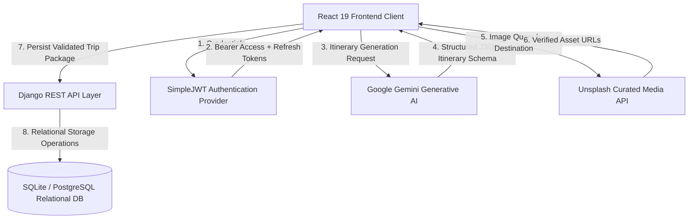

# Tourvisto — AI-Powered Travel Management & Itinerary Intelligence Platform

[](https://www.python.org/)
[](https://www.djangoproject.com/)
[](https://www.django-rest-framework.org/)
[](https://react.dev/)
[](https://ai.google.dev/)
[](https://www.syncfusion.com/)
[](LICENSE)

Tourvisto is an enterprise-grade full-stack travel operations and itinerary generation platform. It couples a decoupled **Django REST Framework** backend with a high-performance **React 19** single-page application, featuring an automated generative travel planner powered by the **Google Gemini API** (`@google/genai`), interactive geographic geospatial analytics via **Syncfusion Maps**, and role-based **JSON Web Token (JWT)** session management.

---

## Architecture Overview

Tourvisto is designed around a decoupled client-server architecture:
- **Presentation Layer (React 19 + Vite):** Responsive dashboard containing operational metrics, interactive SVG travel maps, paginated catalog tables, and modal itinerary inspection.
- **AI Intelligence Pipeline:** Connects client specifications (destination, group dynamics, travel style, duration, budgetary parameters) to Gemini 2.5 / Pro models, enforcing strict JSON schema contracts with fallback validation before saving to persistent storage.
- **Application & Persistence Layer (Django REST Framework):** Relational schema maintaining strict referential integrity across custom traveler profiles, multi-day itineraries, granular daily activities, and media assets.



---

## Core Capabilities

### 1. Generative AI Itinerary Engine
- **Schema-Enforced Extraction:** Transforms human travel desires into structured JSON payloads detailing trip titles, descriptions, price boundaries, seasonal windows, weather expectations, and day-by-day activity timelines.
- **Multimodal Visual Pairing:** Integrates dynamic high-resolution destination imagery fetched and mapped to country/city targets.

### 2. Relational Travel Hierarchy
The database architecture guarantees clean parent-child cascades:
- **`Trip`**: Stores macro-level properties (country, pricing, target group, weather considerations, and geographic coordinates).
- **`ItineraryDay`**: Foreign-key child indexing chronological day numbers and sub-destinations.
- **`Activity`**: Granular itemization of Morning, Afternoon, and Evening activities with contextual descriptions.
- **`TripImage`**: Linked gallery records for multi-asset panoramic displays.

### 3. Identity & Session Security
- **Custom Traveler Model:** Built upon Django's `AbstractBaseUser` and `PermissionsMixin` with unique traveler handles and email normalization.
- **Custom JWT Claims:** `MyTokenObtainPairSerializer` injects user handles and administrative flags directly into the decoded token payload for frictionless client hydration.
- **Defensive CORS & CSRF:** Explicit whitelist origin enforcement and automated CSRF cookie exchange for dual-channel protection.

---

## API Reference

| Endpoint | Method | Authentication | Description |
| :--- | :--- | :--- | :--- |
| `/api/token/` | `POST` | Public | Authenticates credentials; returns Access & Refresh JWTs with custom user claims. |
| `/api/token/refresh/` | `POST` | Public | Exchanges a valid refresh token for a fresh access token. |
| `/registerUser/` | `POST` | Public | Creates a new traveler account with encrypted password hashing. |
| `/users/` | `GET` | Bearer Token | Retrieves a paginated roster of registered travelers. |
| `/trips/all/` | `GET` | Bearer Token | Paginated query list of trips with pre-fetched itineraries and images. |
| `/trips/create/` | `POST` | Bearer Token | Atomically validates and persists a new trip with nested day/activity trees. |
| `/trips/tripDetails/<int:id>` | `GET` | Bearer Token | Fetches a full relational graph of a specific trip by identifier. |
| `/csrf/` | `GET` | Public | Sets and returns CSRF cookie token for safe state-mutating requests. |

---

## Repository Structure

```
touristic-agency-dashboard/
├── back/
│   └── tourvisto/
│       ├── manage.py
│       ├── .env.example              # Environment variables template
│       ├── static/                   # Static collection assets
│       ├── media/                    # Architecture diagrams & media
│       ├── tourvisto/                # Project routing & JWT configuration
│       │   ├── settings.py
│       │   ├── urls.py
│       │   └── views.py
│       ├── trips/                    # Travel itineraries, days & activities
│       │   ├── models.py
│       │   ├── serializers.py
│       │   ├── views.py
│       │   └── tests.py              # Automated unit & integration tests
│       └── users/                    # Custom AbstractBaseUser & auth
│           ├── models.py
│           ├── serializers.py
│           ├── views.py
│           └── tests.py              # User manager & auth tests
└── front/
    ├── .env.example                  # Client environment template
    ├── package.json
    ├── vite.config.js
    └── src/
        ├── api/                      # Axios interceptors & auth guards
        ├── Pages/
        │   ├── auth/                 # Sign-in & registration portal
        │   ├── dashboard/            # KPI overview & analytics
        │   ├── newTrip/              # Gemini AI planner interface
        │   ├── trips/                # Trip catalog & detailed view
        │   └── users/                # Administrative user management
        └── assets/                   # SVG icons and visual assets
```

---

## Quickstart & Local Setup

### 1. Prerequisites
- Python 3.10+
- Node.js 18+ and npm

### 2. Backend Installation & Migration

```bash
# Navigate to backend directory
cd back/tourvisto

# Create and activate virtual environment
python -m venv .venv
source .venv/bin/activate  # On Windows: .venv\Scripts\activate

# Install dependencies
pip install django djangorestframework djangorestframework-simplejwt django-cors-headers pillow

# Copy environment template
cp .env.example .env

# Apply database migrations
python manage.py migrate

# Execute automated test suite (13 test cases)
python manage.py test

# Start Django development server
python manage.py runserver 8000
```

### 3. Frontend Installation & Launch

```bash
# Navigate to frontend directory
cd ../../front

# Install dependencies
npm install

# Copy environment template
cp .env.example .env

# Configure your keys in .env:
# VITE_GEMINI_API_KEY=your_key_here
# VITE_UNSPLASH_ACCESS_KEY=your_key_here

# Run development server
npm run dev
```

The application will be live at `http://localhost:5173`, communicating with the backend API on `http://localhost:8000`.

---

## Automated Test Suite

The test suite validates model constraints, user manager integrity, token issuance, authenticated access rules, pagination limits, and nested relational serialization:

```bash
python manage.py test
```
```
Creating test database for alias 'default'...
Found 13 test(s).
System check identified no issues (0 silenced).
.............
----------------------------------------------------------------------
Ran 13 tests in 13.80s

OK
Destroying test database for alias 'default'...
```

---

## License

This project is licensed under the MIT License — see the [LICENSE](LICENSE) file for details.

